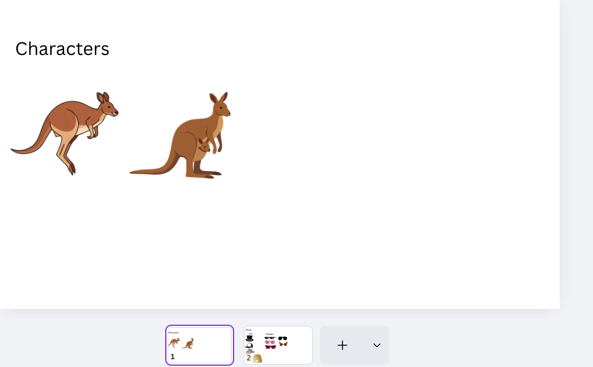
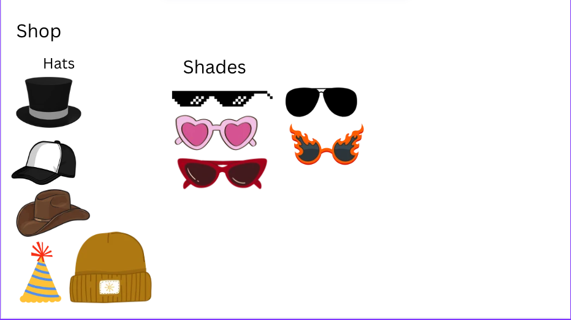
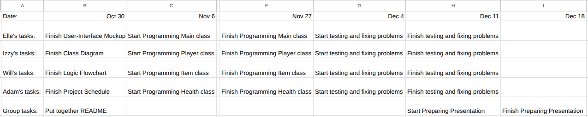
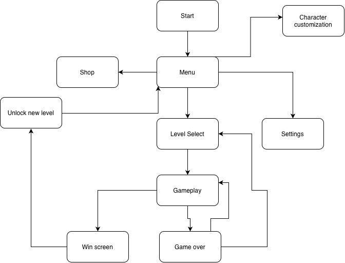

# Group3

# Group Members

Adam McConkie

William Davis

Elle Birgenheier

Isabella Cox

# Overview
Working app or game name: Kangaroo game

This app would be used by anybody who is bored and wants to play a game

The user would click spacebar and jump over obstacles and collecting coins and customizing characters

The main inputs a user puts into the app is the spacebar button to make the kangaroo jump

The smallest working version would be a kangaroo jumping over obstacles

One question out group needs to research is: How can we make our app more fun or more useful than other apps of this type.

# Class Diagram

# UI Mockups 

# Project Schedule

# Flow Chart

